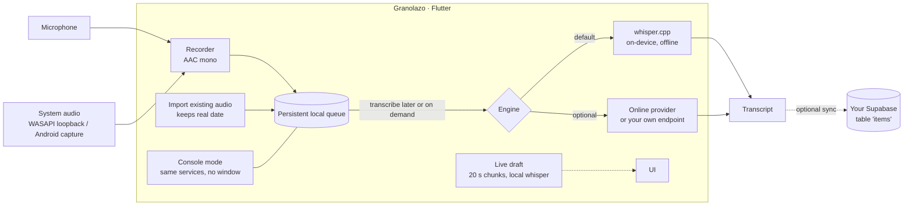

# Granolazo

**Record meetings and transcribe them on your own machine — Windows and Android, one Flutter codebase.**
Audio never has to leave the device: transcription runs locally with [whisper.cpp](https://github.com/ggml-org/whisper.cpp),
free and offline. Everything the UI can do, the same executable can do from a terminal.

> Spanish-language app (UI and code comments), built because meeting-capture tools are either closed SaaS or
> a pile of scripts running on laptops that go to sleep. *Resumen en español al final.*



## Highlights

| | |
|---|---|
| **Local transcription** | whisper.cpp via `whisper_ggml` (`base` 148 MB · `small` 488 MB · `medium` 1.5 GB). No account, no API key, no minutes billed. |
| **Record now, transcribe later** | New recordings wait in a persistent queue. Record offline, without a key, then decide when and with which engine to transcribe. |
| **Mic + system audio** | Captures both sides of a call (native WASAPI loopback on Windows, system capture on Android). |
| **Meeting detector** | Notices when a meeting app is in front and offers to start recording (Android usage-access permission, opt-in). |
| **Live draft** | Optional: while recording, a local whisper pass produces a rolling draft in ~20 s chunks; it is dropped/merged instead of queueing up if the CPU can't keep up. Never leaves the device. |
| **Scriptable** | `granolazo_app.exe estado \| importar \| grabar \| procesar \| modelo \| config` — headless, same services as the UI, `--json` output for scripts. On Android through `adb shell am broadcast`. |
| **Secrets handled right** | Optional online-engine key lives in the OS secure store (Keystore / DPAPI), never in plain prefs or the binary. |
| **Windows video backup** | Optional: resumable upload of a recordings folder to Google Drive, then frees disk space. |

## Quick start

Requires Flutter (Dart `^3.13`). Windows build needs Developer Mode on (plugin symlinks); on Windows/Linux the
local engine uses the system `ffmpeg` if the audio is not already 16 kHz mono WAV (Android bundles its own).

```bash
cp granolazo.env.example granolazo.env        # optional: only needed for cloud sync / online engine
flutter pub get
flutter run -d windows                         # or: flutter run (Android device)
flutter test                                   # 15 test files: queue, CLI, live engine, detector, backup…
```

Pick the model in *Ajustes* or from the terminal:

```bash
granolazo_app.exe modelo --usar small --bajar  # download + select
granolazo_app.exe importar reunion.m4a --procesar
granolazo_app.exe estado --json
```

## Optional cloud sync

By default nothing is uploaded. If you point the app at a Supabase project (`GRANOLAZO_URL`, `GRANOLAZO_ANON_KEY`
via `--dart-define-from-file=granolazo.env`), each finished transcript is written as a row in an `items` table, with
an idempotent id (`app-<platform>-<local id>`) so retrying never duplicates. **The backend schema is not part of this
repository** — this is only the client. Never put a `service_role` key in the build: it ends up inside the installer.

## Layout

```
lib/
  cli/            console mode (commands, JSON output)
  services/       recorder, local + online transcribers, persistent queue, settings (secure store), Drive backup
  en_vivo/        live-draft engine (PCM chunking, whisper worker, local status server)
  controllers/    orchestrates record → transcribe → sync
  ui/             screens (home/queue, meetings, transcript, settings, backup)
android/          Kotlin: foreground recording service, meeting watcher, system capture, CLI receiver
windows/runner/   C++: WASAPI system-audio capture, console channel
test/             unit and widget tests
```

## Known limitations

- Android release builds are signed with the debug key unless you add your own keystore (an APK built on another
  machine will not update over the previous one).
- Audio files are not uploaded, only transcripts.
- With the online engine, very long recordings hit the provider's per-request limit and the app says so instead of
  splitting silently (the local engine has no such limit).
- `flutter test` on Linux: 128/133 pass. The 4 meeting-detector tests read the Windows mic registry and only pass on Windows; one backup test is timing-sensitive under heavy load.
- Not verified on iOS / macOS / Linux desktop (Windows and Android only).
- UI strings are Spanish; there is no i18n layer yet.

## License

[MIT](LICENSE). whisper.cpp and the Flutter plugins keep their own licences (see `pubspec.lock`).

---

## Resumen en español

Granolazo graba reuniones (micrófono + audio del sistema) en Windows y Android y las transcribe **en el propio equipo**
con whisper.cpp: gratis, sin conexión y sin claves. Permite grabar ahora y transcribir después, importar audios con su
fecha real, ver un borrador en vivo mientras se graba y manejar todo por línea de comandos. La sincronización a un
Supabase propio es opcional y el backend no está en este repositorio.
